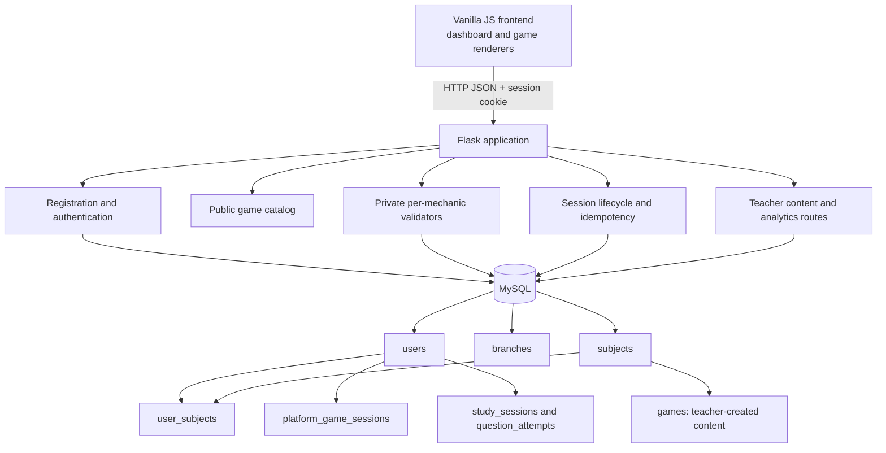
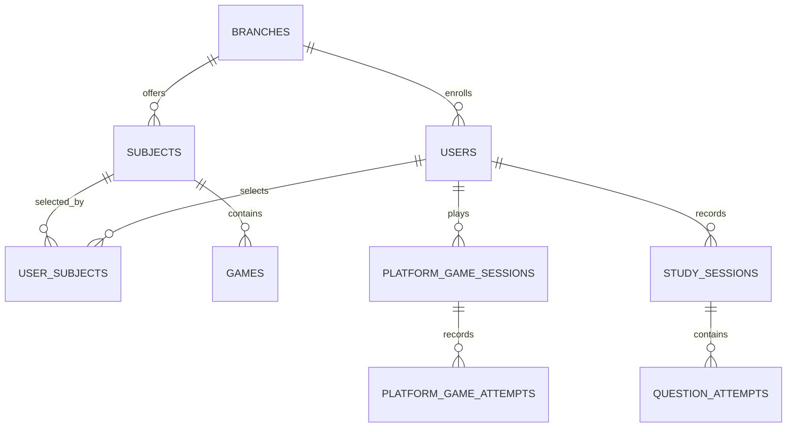

# Architecture

The root `app.py` initializes the configured MySQL database and additive schema, then starts Flask. Authentication uses a signed HTTP-only session cookie; password hashes are generated with Werkzeug. The frontend keeps its existing local study-mode model and UI. The platform catalog is fetched from Flask, with each activity rendered by a dedicated mechanic in `frontend/games.js`.

For platform games, the browser receives public prompt data only. Flask retains the answer rules, reloads the session by authenticated owner, validates each UUID-keyed action, computes score, accuracy, duration and XP, then persists the result transactionally. Completed, exited and abandoned are terminal states; a new game abandons the prior active run. Refresh preserves an active run for resume. The DSA language selection is included in saved session state. Teacher analytics are role-gated and aggregate completed legacy summaries and platform game runs.

**Trust boundary:** platform game scores and rewards are server-computed and action/session writes are idempotent. The legacy `/api/sessions` endpoint still accepts browser-reported score and accuracy for the original local game modes. Code activities are prepared-response exercises and do not run arbitrary source code. Teacher-created rows in `games` can be reviewed in the teacher panel but are not dynamically added to the platform catalog.
